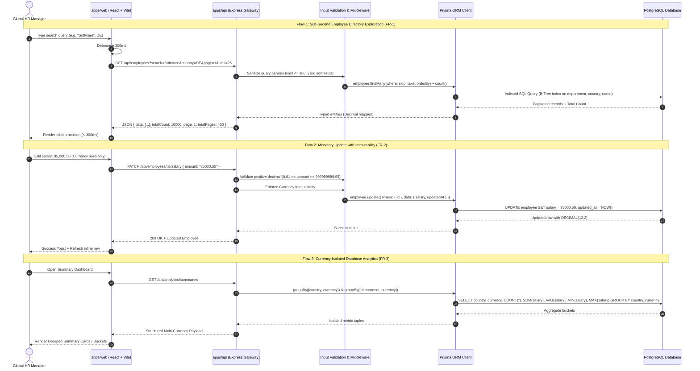

# Incubyte Salary Management — System Architecture

**Document Version:** 1.0.0  
**Status:** Approved Foundation  
**Target Scope:** P0 MVP & Enterprise Foundation for 10,000 Employees  

---

## 1. Executive Summary & Goals

The Incubyte Salary Management application is a centralized web platform for Global HR Managers to search, filter, inspect, and update compensation for 10,000+ employees distributed across international subsidiaries. 

### Core Architectural Drivers
1. **Low Latency on 10,000 Records:** Sub-second UI updates, debounced inputs, and server-side pagination ensuring API P95 response times under 200ms.
2. **Strict Monetary Integrity:** Absolute avoidance of IEEE-754 floating-point errors by leveraging database-native `DECIMAL(12,2)` precision and validated integer/decimal representations.
3. **Currency-Isolated Analytics:** Strict mathematical isolation of financial aggregations by `(Country, Currency)` and `(Department, Currency)` to prevent financial reporting distortion.
4. **Clean Module Boundaries & Maintainability:** A unified TypeScript monorepo with strict package boundaries, type safety across boundaries, and deterministic builds.

---

## 2. Monorepo Organization & Module Boundaries

The project is structured as an npm workspaces monorepo:

```text
salary_management/
├── apps/
│   ├── api/                     # Node.js + Express backend service
│   │   ├── prisma/              # Prisma schema, migrations, seeders
│   │   ├── src/                 # Controllers, services, routes, middleware
│   │   └── package.json         # @incubyte/api
│   └── web/                     # React 18 + Vite frontend single-page application
│       ├── src/                 # UI components, state hooks, styling tokens
│       └── package.json         # @incubyte/web
├── docs/                        # Specifications, PRD, and architecture guides
├── package.json                 # Monorepo root workspace orchestration
└── package-lock.json            # Single source of truth for dependencies
```

### Module Boundaries & Responsibilities

| Boundary | Technology | Primary Responsibilities | Strict Constraints |
| :--- | :--- | :--- | :--- |
| **`apps/web`** | React 18, Vite, TypeScript, Vanilla CSS | User interface, state management, debounced search (300ms), optimistic UI feedback, accessible form controls. | Never performs client-side financial conversions or raw data sums across currencies. |
| **`apps/api`** | Node.js, Express, TypeScript | Input validation, routing, error handling, health monitoring (`/api/health`), database connection pooling, orchestration. | Stateless; delegates raw arithmetic aggregations to PostgreSQL. |
| **`Data Layer`** | PostgreSQL, Prisma ORM | Persistent storage, ACID transactions, column indexes (`name`, `country`, `department`, `currency`), multi-currency `GROUP BY` aggregations. | Stores currency as immutable 3-letter ISO code; stores salary as `DECIMAL(12,2)`. |

---

## 3. End-to-End Request Flow

The diagram below illustrates how client interactions traverse through the system stack:



---

## 4. Database Selection & Precision Strategy

### Why PostgreSQL?
1. **Fixed-Point Arithmetic (`DECIMAL` / `NUMERIC`):** PostgreSQL natively supports arbitrary-precision numbers. Floating-point types (`FLOAT`, `DOUBLE PRECISION`) use binary approximation and accumulate rounding errors over repetitive sums or tax calculations. PostgreSQL `DECIMAL(12,2)` guarantees exact cent representation up to `999,999,999.99`.
2. **Reliable Performance on 10,000+ Records:** With B-Tree indexes on `department`, `country`, `currency`, and `name`, PostgreSQL executes queries on 10k rows in < 15ms, comfortably exceeding the 50ms requirement.
3. **Expressive Aggregate Functions:** PostgreSQL handles grouped statistics (`SUM`, `AVG`, `MIN`, `MAX`, `COUNT`) with high efficiency directly inside the storage engine, avoiding loading 10k objects into Node.js heap memory.

### Indexing Scheme
```prisma
model Employee {
  id           String   @id @default(uuid())
  employeeCode String   @unique
  firstName    String
  lastName     String
  name         String
  email        String   @unique
  jobTitle     String
  department   String
  country      String
  currency     String   // ISO 4217 (e.g., USD, EUR, GBP, INR, JPY)
  salary       Decimal  @db.Decimal(12, 2)
  createdAt    DateTime @default(now())
  updatedAt    DateTime @updatedAt

  @@index([department])
  @@index([country])
  @@index([currency])
  @@index([employeeCode])
  @@index([firstName])
  @@index([lastName])
  @@index([name])
  @@index([email])
}
```

### 4.2 Implemented Employee Read API Contract (`GET /api/employees`)

| Parameter | Type | Default | Validation & Rules |
| :--- | :--- | :--- | :--- |
| `search` (or `q`) | String | — | Max 100 chars. Case-insensitive search across `employeeCode`, `firstName`, `lastName`, `name`, and `email`. |
| `country` | String | — | Max 100 chars. Exact/case-insensitive match on employee's country. |
| `department` | String | — | Max 100 chars. Exact/case-insensitive match on employee's department. |
| `currency` | String | — | Optional 3-letter ISO 4217 code (e.g. `USD`, `EUR`, `GBP`). |
| `page` | Integer | `1` | Must be an integer `>= 1`. |
| `limit` | Integer | `25` | Must be an integer between `1` and `100`. |
| `sortBy` | String | `name` | Allowlisted: `name`, `firstName`, `lastName`, `employeeCode`, `department`, `country`, `salary`, `createdAt`. |
| `sortOrder` | String | `asc` | Allowlisted: `asc`, `desc`. |

**Deterministic Tie-Breaker:**  
All sorting queries append a secondary `{ id: 'asc' }` tie-breaker to prevent pagination jitter when primary sort values are identical.

**Pagination Metadata Response:**
```json
{
  "data": [
    {
      "id": "uuid",
      "employeeCode": "EMP-001",
      "firstName": "John",
      "lastName": "Doe",
      "name": "John Doe",
      "email": "john.doe@example.com",
      "jobTitle": "Senior Software Engineer",
      "department": "Engineering",
      "country": "US",
      "currency": "USD",
      "salary": "125000.00",
      "createdAt": "2024-01-15T10:00:00.000Z",
      "updatedAt": "2024-01-15T10:00:00.000Z"
    }
  ],
  "pagination": {
    "page": 1,
    "limit": 25,
    "totalCount": 10000,
    "totalPages": 400,
    "hasNextPage": true,
    "hasPreviousPage": false
  }
}
### 4.3 Implemented Salary Update API Contract (`PATCH /api/employees/:id/salary`)

**Endpoint:** `PATCH /api/employees/:id/salary`  
**Purpose:** Updates an employee's annual base salary with decimal-safe validation and currency immutability.

**Request Validation Rules:**
- **URL Parameter (`id`):** Non-empty string, trimmed, maximum 128 characters.
- **Request Body (`salary` or alias `amount`):**
  - Positive numeric value or numeric string.
  - Strict range: `0.01 <= salary <= 999,999,999.99`.
  - Precision: At most 2 decimal places (`DECIMAL(12,2)`).
  - Rejection: Negative numbers, zero, `NaN`, exponents/scientific notation, non-numeric characters, and missing fields return `400 Bad Request`.
- **Currency Immutability:**
  - If `currency` is passed in the request body, it MUST match the employee's existing contract currency. Any attempt to modify the currency returns `400 Bad Request` with message: `"Currency code is immutable and cannot be modified."`
- **Employee Existence:**
  - If `:id` is not found, returns `404 Not Found` with message: `"Employee with ID '<id>' not found."`
- **Sensitive Data Handling:**
  - Salary values and compensation figures are not emitted into application access logs.

**Response Body (HTTP 200 OK):**
```json
{
  "data": {
    "id": "emp-uuid-002",
    "employeeCode": "EMP-002",
    "firstName": "Alice",
    "lastName": "Schmidt",
    "name": "Alice Schmidt",
    "email": "alice.schmidt@example.de",
    "jobTitle": "Engineering Lead",
    "department": "Engineering",
    "country": "DE",
    "currency": "EUR",
    "salary": "98500.75",
    "createdAt": "2024-02-01T10:00:00.000Z",
    "updatedAt": "2026-10-17T12:00:00.000Z"
  }
}
```

---

## 5. Key Trade-offs & Architectural Decisions

### 1. npm Workspaces vs. Turborepo / Nx
- **Decision:** Use native npm workspaces with unified scripts.
- **Rationale:** Keeps infrastructure lightweight without extra daemon complexity, binary downloads, or learning curves. For a two-app monorepo (`web` and `api`), npm workspaces delivers clear dependency sharing and single lockfile guarantees while meeting all project requirements.

### 2. Prisma ORM vs. Raw SQL (e.g. pg-promise / Kysely)
- **Decision:** Use Prisma ORM with PostgreSQL.
- **Rationale:** Generates type-safe TypeScript interfaces directly from the schema, provides automated database migrations, and exposes native `Prisma.Decimal` support that maps directly onto PostgreSQL `DECIMAL(12,2)`. Complex aggregation queries can still leverage Prisma's `groupBy` or `$queryRaw` when needed.

### 3. Strict Currency Grouping vs. Reference Exchange Rates
- **Decision:** Display metrics strictly grouped by `(Country, Currency)` and `(Department, Currency)`.
- **Rationale:** Summing or averaging disparate currencies (e.g., 50,000 JPY + 50,000 USD = 100,000) produces meaningless and dangerous financial figures. Without a licensed, live FX market rate provider in MVP, currency isolation is the only financially sound solution.

### 4. Authentication Scope for MVP
- **Decision:** API is unauthenticated in MVP, focusing on core performance, data fidelity, and UX.
- **Trade-off:** Ideal for technical assessment, internal network, or VPN deployment. The architecture cleanly isolates routing in Express, allowing JWT or session middleware to be mounted at `/api/*` in post-MVP phases without refactoring business services.

### 5. Salary Audit History as a Deliberate MVP Exclusion
- **Decision:** Track compensation updates via automatic `updatedAt` timestamp on the `Employee` model in MVP, deferring historical change ledgers (`SalaryAuditLog`) to Phase P1.
- **Rationale:** Section 3 (P1 Enhancements) and Section 5 (Decisions Requiring Approval) of `docs/requirements.md` explicitly isolate the P0 MVP boundary to sub-second exploration, currency-isolated summaries, and validated salary edits. Adding audit log tables without finalized compliance requirements would introduce premature schema coupling. Atomic timestamps fulfill MVP auditability while preserving a seamless migration path to a dedicated immutable change log table in P1.

---

## 6. Path to P0 Feature Completion

With this foundation verified:
1. **FR-1 (Exploration):** `/api/employees` GET endpoint with filtering/sorting/pagination completed.
2. **FR-2 (Update):** `/api/employees/:id/salary` PATCH endpoint with precision validation completed.
3. **FR-3 (Summaries):** Build `/api/analytics/summaries` GET endpoint with SQL `GROUP BY` and React summary cards.
4. **FR-4 (Seeding):** Implement deterministic 10k seed script using deterministic pseudo-random sequences across 5+ countries and currencies.

